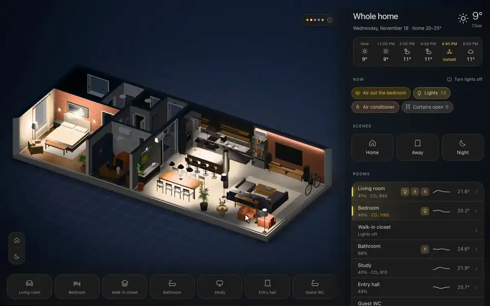

# Home Twin

A live 3D twin of your home for Home Assistant: draw the floor plan, place lights, devices and sensors, and see the home in 3D with live states.

> **Status: beta.** Home Twin 0.3.x works for single-floor homes: the floor-plan editor, the Home Assistant panel and the dashboard card. Expect rough edges, and please report them in [Issues](https://github.com/Alex-2t/home-twin/issues) with your Home Assistant version, browser and a screenshot. What each version brought is in [Releases](https://github.com/Alex-2t/home-twin/releases).
>
> **Build with AI** is a paid early-access service inside the editor: film one walk through your home, and the rooms, windows, doors and furniture are built for you. The video or photos are uploaded to our server for processing and kept with your account; everything else in Home Twin runs locally in Home Assistant and needs no account. See the [terms](https://twin.sync.md/terms) and [privacy policy](https://twin.sync.md/privacy).

 

## Install
1. Add this repository and download **Home Twin**, then restart Home Assistant:
   - Home Assistant 2026.11 and newer: Marketplace → **Add from link** → `https://github.com/Alex-2t/home-twin` (the Marketplace asks to connect a GitHub account first, as for any repository outside its catalog).
   - Older versions with [HACS](https://hacs.xyz): HACS → ⋮ → **Custom repositories** → `https://github.com/Alex-2t/home-twin`, type **Integration**.
2. Settings → Devices & services → Add integration → **Home Twin**.
3. Click **Draw your home** in the dialog that follows. Later, open **Home Twin** in the sidebar (or Settings → Devices & services → Home Twin → Configure).
4. Put the home on a dashboard: click **Add to dashboard** at the end of the setup (or in the plan menu) — a dashboard with your home appears in the sidebar. You can also add the **Home Twin** card to any dashboard (`type: custom:home-twin-card`): there it is a compact window into the home, and a tap opens the whole home.

Manual install: download `home_twin.zip` from the latest release, unzip it into `config/custom_components/home_twin`, restart Home Assistant.

The editor is for administrators; the card is for everyone in the home (only administrators change its scenes and layout). The plan and its photo are stored in Home Assistant (`.storage/home_twin.plan`, `.storage/home_twin.photo`) and are included in backups, so every computer and browser sees the same plan. Two more files may appear there: `home_twin.plan.format<N>`, the plan as it was before an update changed its format, and `home_twin.ai`, the sign-in to your AI build account once you have signed in from the panel (it is kept for the whole home, so every browser of this Home Assistant is signed in at once). Removing the integration keeps all of them, so reinstalling brings them back; delete those files to remove them completely, `home_twin.ai` included if you want the account signed out of this Home Assistant.

## What it does
- **Draw the floor plan** over a photo of your plan or by eye: rooms, walls, windows and doors, with sizes in metres.
- **Furnish it** from a catalog of furniture, and place the lights, curtains, climate devices and sensors you already have in Home Assistant.
- **See it live in 3D**: lights go on and off as they do at home, doors and windows open, sensors show their readings in their rooms.
- **Put it on a dashboard**: a Home Twin dashboard for everyone in the home, or a compact card on any dashboard that opens the whole home on a tap.
- **Build with AI**: film one walk through your home and get the rooms, openings and furniture built for you, then review and move what needs it (paid, see above).
- **In your language**: English, German, French, Spanish, Italian, Dutch, Polish, Portuguese, Russian and Chinese.

## Requirements and limitations
- Home Assistant 2024.7 or newer, installed as above. The editor is for administrators; the card and the dashboard are for everyone in the home.
- A browser with WebGL. A phone or tablet is fine for watching the home and using the card; drawing is more comfortable with a mouse.
- One floor per home for now; two-storey houses, basements and attics are on the roadmap. The outside of the house (facade, roof, plot) is not drawn yet.
- After the AI build, the lights are placed by you, step by step. The AI builds the rooms, openings and furniture; in Home Assistant it also links the rooms to your areas and puts your curtains and air conditioners on the ones the video showed.

## Roadmap

<picture>
  <source media="(prefers-color-scheme: dark)" srcset="docs/images/roadmap-dark.svg">
  
</picture>

After the first release, in no fixed order and without dates:

- **More devices in 3D** — more kinds of devices come alive in the model (a TV, a fan, a purifier, a washing machine, a lock, a camera, a garage door), and the ones there today get finer 3D models.
- **Scan with your phone** — walk through the home with the phone's camera and LiDAR, and the plan and the 3D home build as you go; walk up to a part that came out poorly and it fills in live.
- **More than one floor** — two-storey houses, flats on two levels, basements and attics.
- **The outside** — the facade, the roof and the plot, with outdoor lights, gates and sensors where they really are.
- **Real sun and weather** — the light follows the real time of day, the home's orientation and the sky.
- **The day, replayed** — drag a timeline back and watch the lights, doors, motion and temperature play out.
- **Climate on the plan** — a heat map of temperature, humidity or CO₂ room by room; energy drawn on the devices that use it.
- **People and motion** — rooms light up where someone is; the robot vacuum moves along its real path.

Want these sooner? [Buy me a coffee on Ko-fi](https://ko-fi.com/hometwin) — Home Twin is free and open, and support keeps it moving. A ⭐ star on GitHub helps too: it is how others find Home Twin.

License: [GPL-3.0](LICENSE).

## Development

The repository holds the code. It contains no personal data from the owner's apartment: its demo and plan photo are kept local only (`editor/demo/own.ts` is in `.gitignore`); without them the demo is an invented typical apartment.

- [Editor](editor/README.md) — how to build, run and test it
- [Home Assistant integration](integration/README.md) — how it works, test HA in Docker, releasing a version
- [Plan format](docs/plan-format.md) — the plan file and its versions
- [Code style](docs/code-style.md)

Comments and documents cite decisions as `D-056` and the like: the number is a stable handle on the author's decision log, kept outside the repository with the rest of the product notes. The code around a citation says what was decided; the number only tells which conversation it came from.
