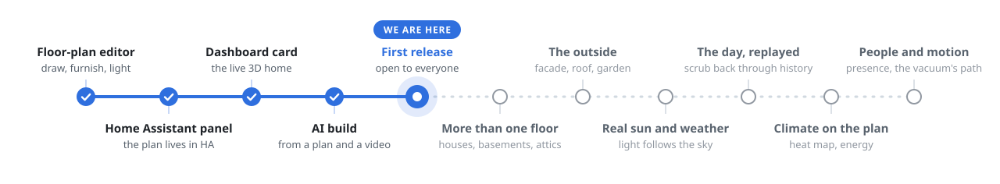

# Home Twin

A live 3D twin of your home for Home Assistant: draw the floor plan, place lights, devices and sensors, and see the home in 3D with live states. Early alpha.

## Install
1. Add this repository and download **Home Twin**, then restart Home Assistant:
   - Home Assistant 2026.11 and newer: Marketplace → **Add from link** → `https://github.com/Alex-2t/home-twin` (the Marketplace asks to connect a GitHub account first, as for any repository outside its catalog).
   - Older versions with [HACS](https://hacs.xyz): HACS → ⋮ → **Custom repositories** → `https://github.com/Alex-2t/home-twin`, type **Integration**.
2. Settings → Devices & services → Add integration → **Home Twin**.
3. Click **Draw your home** in the dialog that follows. Later, open **Home Twin** in the sidebar (or Settings → Devices & services → Home Twin → Configure).
4. Put the home on a dashboard: click **Add to dashboard** at the end of the setup (or in the plan menu) — a dashboard with your home appears in the sidebar. You can also add the **Home Twin** card to any dashboard (`type: custom:home-twin-card`): there it is a compact window into the home, and a tap opens the whole home.

Manual install: download `home_twin.zip` from the latest release, unzip it into `config/custom_components/home_twin`, restart Home Assistant.

The editor is for administrators; the card is for everyone in the home (only administrators change its scenes and layout). The plan and its photo are stored in Home Assistant (`.storage/home_twin.plan`, `.storage/home_twin.photo`) and are included in backups, so every computer and browser sees the same plan. Removing the integration keeps them, so reinstalling brings them back; delete those files to remove them completely.

## Roadmap

<picture>
  <source media="(prefers-color-scheme: dark)" srcset="docs/images/roadmap-dark.svg">
  
</picture>

After the first release, in no fixed order and without dates:

- **More devices in 3D** — more kinds of devices come alive in the model (a TV, a fan, a purifier, a washing machine, a lock, a camera, a garage door), and the ones there today get finer 3D models.
- **More than one floor** — two-storey houses, flats on two levels, basements and attics.
- **The outside** — the facade, the roof and the plot, with outdoor lights, gates and sensors where they really are.
- **Real sun and weather** — the light follows the real time of day, the home's orientation and the sky.
- **The day, replayed** — drag a timeline back and watch the lights, doors, motion and temperature play out.
- **Climate on the plan** — a heat map of temperature, humidity or CO₂ room by room; energy drawn on the devices that use it.
- **People and motion** — rooms light up where someone is; the robot vacuum moves along its real path.

Want these sooner? [Buy me a coffee on Ko-fi](https://ko-fi.com/hometwin) — Home Twin is free and open, and support keeps it moving.

License: [GPL-3.0](LICENSE).

## Development

The repository holds the code. It contains no personal data from the owner's apartment: its demo and plan photo are kept local only (`editor/demo/own.ts` is in `.gitignore`); without them the demo is an invented typical apartment.

- [Editor](editor/README.md) — how to build, run and test it
- [Home Assistant integration](integration/README.md) — how it works, test HA in Docker, releasing a version
- [Plan format](docs/plan-format.md) — the plan file and its versions
- [Code style](docs/code-style.md)
