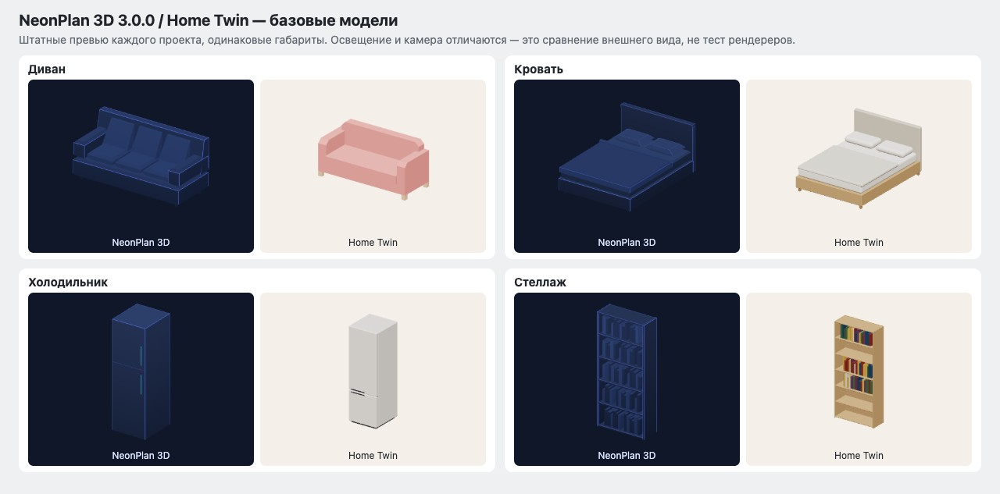

# NeonPlan 3D and Home Twin: Catalog and Model Quality

**Comparison of early versions.** The conclusions and images below refer to the check of 2026-11-04, when Home Twin had 30 catalog entries. Since then the range and generators have changed; this is not a current product comparison. The current catalog numbers are in [status.md](../status.md), the history of expansion in [furniture-catalog.md](furniture-catalog.md).

Check: 2026-11-04. NeonPlan means the original **Mastershort/neonplan3d**, not a third-party fork. Version **3.0.0** was checked, commit `00ee13f0296432d0fdff66b497682c2bfe79eefe`. Our catalog is the state after adding the refrigerator, 30 entries.

Conclusion: **NeonPlan is clearly ahead in range, configurations, and library readiness. There is no unconditional superiority of Home Twin in model quality.** Our own items give a more natural perception of materials and soft edges, but the Kenney sofa is simpler than their built-in sofa. Both catalogs use stylized models, not photorealistic scans.

## How many items there actually are

| What we count | Count | How checked |
|---|---:|---|
| NeonPlan built-in types | **80** | Recounted the `FURNITURE_TYPES` rows in the source code |
| Unique types in NeonPlan's standard catalog groups | **68** | Union of `FURNITURE_GROUPS`, the repeated `worktop` excluded |
| Light fixtures among those 68 | **13** | The `lights` group |
| Other items of the standard groups | **55** | Include furniture, appliances, stairs, and other objects; this is not 55 purely furniture types |
| Additional store packs | **1,209 items in 20 packs — claimed by the seller** | The number on the store page; the contents of all paid packs were not recounted |
| Home Twin | **30 entries** | Our `CATALOG`: 17 own generators and 13 ready-made Kenney models |
| Home Twin without repeats of functional types from the research | **26** | Beds, nightstands, and bookshelves merged by purpose |

Sources for a reproducible count: [FURNITURE_TYPES and FURNITURE_GROUPS](https://github.com/Mastershort/neonplan3d/blob/00ee13f0296432d0fdff66b497682c2bfe79eefe/frontend/src/model.ts#L1346), [basicTypes filter](https://github.com/Mastershort/neonplan3d/blob/00ee13f0296432d0fdff66b497682c2bfe79eefe/frontend/src/library-index.ts#L165), [our catalog](../../editor/src/core/catalog.js).

Outside the regular groups are 12 types: five energy objects (`meter`, `inverter`, `home_battery`, `wallbox`, `grid_point`), five pool objects (`pool_pump`, `pool_filter`, `pool_heat_pump`, `pool_dosing`, `pool_valve`), `fridge_smart`, and `stairwell`. Some are used by separate tools or as special representations. So 80 built-in types do not equal 80 regular furniture cards. The presence of a type in the code also does not mean a special function is available without the corresponding extension.

By NeonPlan group: lights 13; living room 12; dining 6; kitchen 9; bedroom 5; bathroom 6; work/other 10; parking 1; outdoor 1; utility items 2; switches/appliances 4. The sum is 69, unique 68 because the worktop is in two groups.

The [store](https://mastershort.de/product-category/neonplan3d/) claims 727 items in the base 11 packs, 963 in 16, and 1,209 in 20. These are nested bundles, they cannot be added together. The pages contain inconsistencies: text about 40 free items versus 80 types in the code; on the [Basic Bundle page](https://mastershort.de/product/neonplan3d-basic-bundle/) both 727 and the old number 371 appear. For the free part the source code is more reliable; for the paid part the exact total remains the store's claim.

**1,209 items do not mean 1,209 unique constructions.** [library-index.ts](https://github.com/Mastershort/neonplan3d/blob/00ee13f0296432d0fdff66b497682c2bfe79eefe/frontend/src/library-index.ts) groups items into families, size variants, and mirrored versions. The code documentation explicitly gives tables 120/160/200 as variants of one card. The number of unique families in the paid packs is not established here. The packs also include vehicles, animals, architecture, and decor.

## Visual comparison

On the left in each pair is NeonPlan, on the right Home Twin. For each pair the same width, depth, and height are set. The images were produced with both projects' built-in preview functions. Cameras, fit scale, materials, and lighting differ: the picture shows their current look, but is not a geometry comparison under identical lighting. NeonPlan is shown in the preview's neon palette; the whole app also has a light Day and Blueprint. The NeonPlan images were created from Mastershort's open version, [MIT license](https://github.com/Mastershort/neonplan3d/blob/00ee13f0296432d0fdff66b497682c2bfe79eefe/LICENSE).

| Example | What is visible and confirmed by the code | Assessment |
|---|---|---|
| Straight sofa | NeonPlan has separate seat and back cushions, a tilted back, pronounced armrests. Our Kenney sofa has a simpler single silhouette | **NeonPlan is more detailed**; our sofa is a candidate for replacement |
| Bed | Both have a frame, mattress, blanket, and pillows. NeonPlan has a folded-back blanket; our generator has softer rounding and distinguishable wood/fabric | Comparable detail; for a natural interior I prefer our look |
| Refrigerator | Their regular `fridge` is a body with seam/handle lines. Ours has separate volumetric doors, a plinth, rounding, and handle details | **Ours is more detailed than their basic fridge**; this is not a comparison with the special `fridge_smart` or the paid versions |
| Shelving | Both have shelves and books. Ours distinguishes book and wood colors, theirs follows the common neon palette | Similar in construction; our look's advantage is in colors and material, not in fundamentally different geometry |

Geometry was checked against [furniture.ts](https://github.com/Mastershort/neonplan3d/blob/00ee13f0296432d0fdff66b497682c2bfe79eefe/frontend/src/viewer/furniture.ts) and our [furniture3d.js](../../editor/src/core/furniture3d.js). The assessment of appearance is subjective and applies to these examples; the quality of all paid models was not checked.

## Quality as a library for an editor

| Criterion | NeonPlan | Home Twin | Conclusion |
|---|---|---|---|
| Apartment coverage | Already has corner sofas, plumbing, washer, dryer, climate, and appliances | Many main groups are still missing | NeonPlan is ahead |
| Variants | Families, sizes, mirroring, additional packs | A small set, some entries repeat one type | NeonPlan is ahead |
| Resizing | Procedural built-in items; for packs, fixed-thickness parts are supported when stretching | 17 generators resize, 13 Kenney models are fixed in the current interface | NeonPlan covers more cases |
| Materials and overall look | A single stylized language, neon/blueprint/day | Physically lit materials, natural colors, rounding; Kenney sometimes stands out | Our direction has a visual advantage for an ordinary interior, but the style is still uneven |
| Readiness for weak devices | Static furniture is merged into shared scene buffers | Generator parts are still separate Meshes | NeonPlan's architecture is more economical in draw objects; FPS in equal scenes was not measured |
| Live home state | Models and special devices are included in the HA state system | Still a standalone editor with a demo adapter | NeonPlan is more mature as a finished product |

Technical basis: [part scaling](https://github.com/Mastershort/neonplan3d/blob/00ee13f0296432d0fdff66b497682c2bfe79eefe/frontend/src/pack-scale.ts), [renderer](https://github.com/Mastershort/neonplan3d/blob/00ee13f0296432d0fdff66b497682c2bfe79eefe/frontend/src/viewer/viewer3d.ts), [palettes](https://github.com/Mastershort/neonplan3d/blob/00ee13f0296432d0fdff66b497682c2bfe79eefe/frontend/src/viewer/theme.ts). Their base materials and shader effects solve the task of stylized display; our having a more physical material does not by itself make the furniture shape better.

## What to change in our queue

1. Keep the first base groups from the [list of 120](furniture-catalog.md): bathroom, kitchen with appliances, laundry, corner furniture. This is a real gap relative to the competitor.
2. Raise our own straight sofa and armchair above small decor. The current Kenney sofa has too simple a silhouette; it needs separate cushions, a tilted back, and controlled proportions.
3. Build several strong families: sofa, bed, wardrobe, table, kitchen. Sizes and mirroring are parameters; a consistent style matters more than the number of cards.
4. Preserve real dimensions and proportions when resizing. Do not stretch handles, legs, and tabletop thickness together with the body.
5. Merge parts by material before the library grows at scale. A large number of separate Meshes may cost more than the detail itself.

Our realistic advantage is a recognizable apartment with consistent colors and light. It still needs to be secured by furniture quality. The claim "all our models are already better" is not supported.

## Limits of the check

The original project's source code, the store pages, the built-in previews of four pairs, and a local demo of the published version in Neon and Day were reviewed. On first load, the public demo returned a 3D module import error; for the visual check, the unmodified published build from the repository, run locally, was used. This is an observation of a single load, not a conclusion about the product's stability.

Paid packs were not purchased or imported. No comparative FPS test, no quality check of all 80 types, and no full audit of asset rights was performed. The competitor's code and models were not carried into the Home Twin app; only this analysis and the comparison image are kept in the repository.
